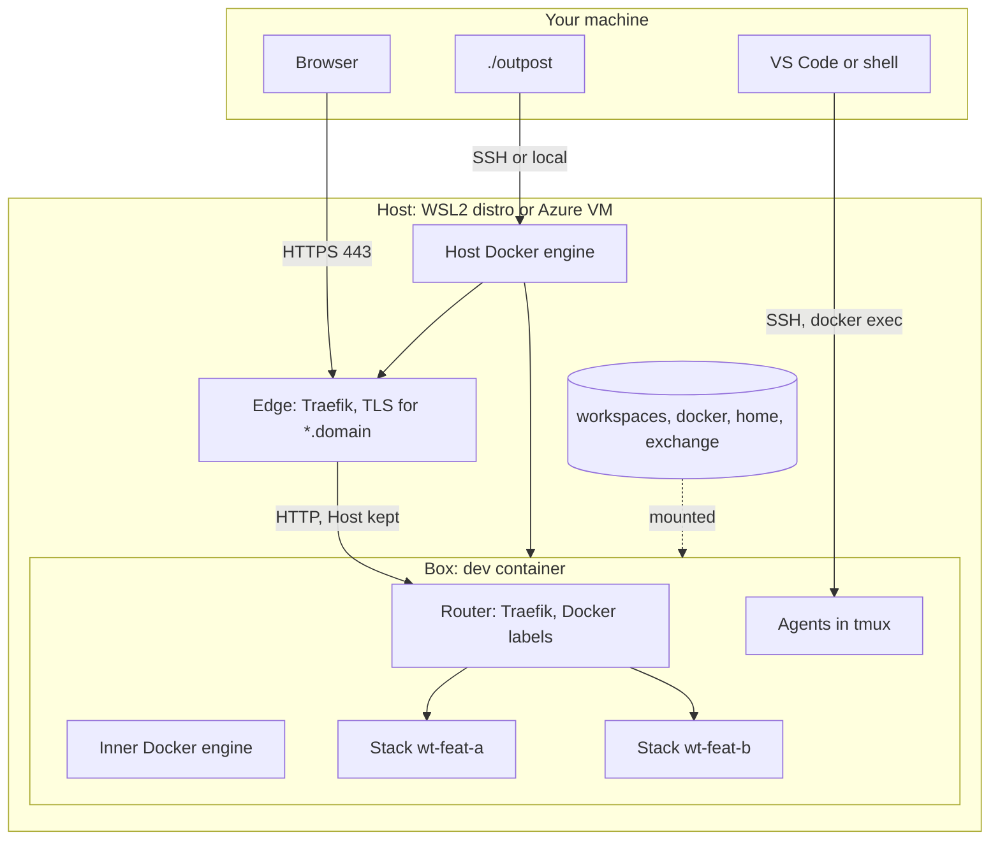
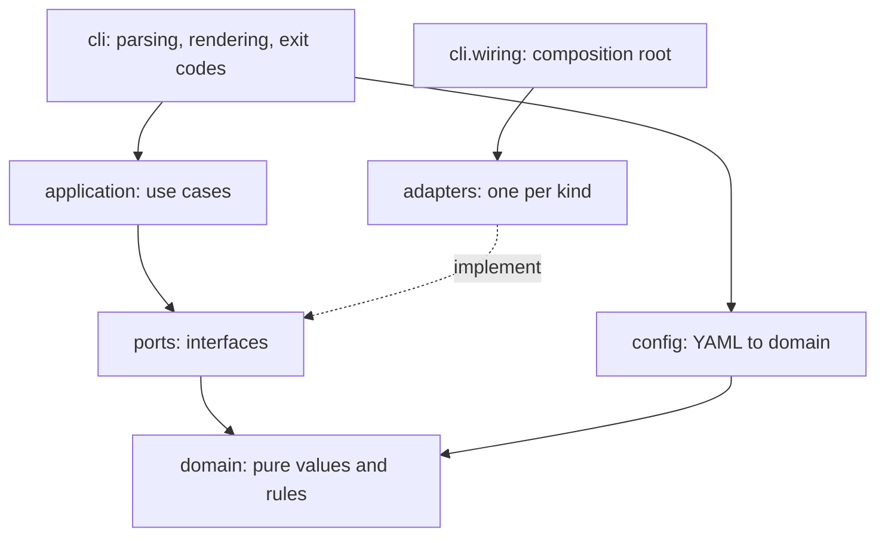

# Architecture

Every request takes the same path on WSL and on Azure: browser, edge, router, stack service. Per target, only two things change: how the client reaches the host, and where the edge's certificate comes from.

## Runtime topology

- The edge holds the only certificate and forwards every hostname under the domain to the router: one catch-all rule, written by [`edge_dynamic_config`](../src/outpost/adapters/proxy/traefik.py#L109-L139).
- The router runs on the box's inner engine and finds stacks from their labels. `outpost up` starts it once the inner engine answers, with [`InnerRouter`](../src/outpost/application/environment.py#L35-L56) and the container from [`TraefikRouter.container`](../src/outpost/adapters/proxy/traefik.py#L160-L173); its restart policy brings it back with the box.
- The CLI never talks to the box directly: it drives the host's engine and runs box commands through `docker exec`.

## New stacks go live without a reload

1. `outpost stack up <worktree>` writes a small compose override for that worktree: router labels for each exposed service and the `outpost-routes` network next to the networks the service already declares. See [`compose_override`](../src/outpost/adapters/stacks/compose.py#L85-L108). Services keep their own restart policies.
2. The router's Docker provider sees the containers start and adds their routes.
3. The edge already forwards `*.<domain>`, and its wildcard certificate already covers the new name.

`stack up` also writes a starter script with the exact `up` command, and the box runs every starter when it starts, through [`ComposeStacks.boot_script`](../src/outpost/adapters/stacks/compose.py#L77-L82). After a reboot the same stacks come back, one-shot jobs such as migrations included, without forcing a restart policy on any service. `stack down` removes the starter.

No host port is allocated per stack: every stack keeps its internal ports, and hostnames tell them apart. Route names are flat, `<service>--<worktree>.<domain>`, because a wildcard certificate covers one label; see [`plan_routes`](../src/outpost/domain/routes.py#L45-L65).

## Same implementation on WSL and Azure

| Concern | WSL (local VM) | Azure VM |
| --- | --- | --- |
| Client to host | `connection.kind: local`, Outpost runs in the distro | `connection.kind: ssh` |
| Domain | `dev.localhost`; Chromium and Firefox resolve `*.localhost` to loopback | Your domain with a wildcard DNS record |
| Edge listens on | `127.0.0.1`, reached from Windows by WSL localhost forwarding | The VPN interface, or `0.0.0.0` behind an NSG allowlist |
| Certificate | `local-ca`, trusted once with `outpost tls trust` | `acme`, Let's Encrypt wildcard through DNS-01 |
| Isolation | `privileged` | `sysbox` |

## Persistence

| What | Volume or path | Mounted at |
| --- | --- | --- |
| Clone, worktrees, build outputs | `outpost-<project>-workspaces` | `/workspaces` |
| Inner images, containers, stack volumes | `outpost-<project>-docker` | `/var/lib/docker` |
| `~/.claude`, `~/.config/gh`, NuGet cache | `outpost-<project>-home` | `/home/<user>` |
| Files shared with your machine | `<state_dir>/exchange` on the host | `/exchange` |
| Edge certificates, ACME account | `outpost-<project>-edge-data` | `/data` in the edge |

The box image adds Outpost's layer to the base image; the init script in `src/outpost/resources/box/` prepares cgroups for the inner engine, starts it, then runs the starters. The box container is built by [`box_container`](../src/outpost/application/box.py#L55-L73). Containers are recreated only when their spec changes, by [`converge`](../src/outpost/application/containers.py#L21-L42); volumes always survive.

## Code layers

- Arrows are imports, checked by the contracts in `pyproject.toml`.
- The use cases are [`Environment`](../src/outpost/application/environment.py#L59-L154), [`Doctor`](../src/outpost/application/doctor.py#L40-L69), [`CredentialSync`](../src/outpost/application/credentials.py#L26-L103), [`Worktrees`](../src/outpost/application/worktrees.py#L20-L46), [`Stacks`](../src/outpost/application/stacks.py#L12-L46) and [`BoxSession`](../src/outpost/application/session.py#L13-L21).
- The composition root is [`App`](../src/outpost/cli/wiring.py#L60-L205); it is the only module that names an adapter class.
